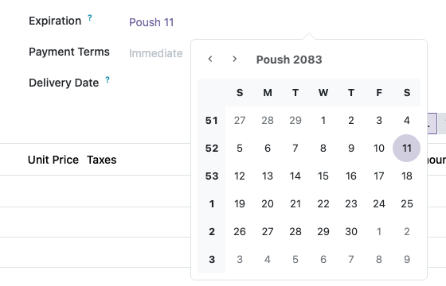

# Nepali Date Picker (Bikram Sambat) for Odoo

An Odoo 20.0 module that lets each user show, type and pick dates in the Nepali
Bikram Sambat (BS) calendar. Dates are still stored in the Gregorian calendar, so
reports, filters and other modules are not affected.



## Features

- A per-user **Date Calendar** preference: Gregorian (AD) or Nepali (Bikram Sambat).
- BS dates in form and list views, such as "Magh 1, 2083".
- BS input: `2083-10-01`, `2083/10/1`, `20831001`, Devanagari digits.
- A date picker with BS months (29 to 32 days), years and decades.
- Supported range: 1970 to 2090 BS (1913 to 2034 AD).

Calendar and Gantt views, search filters and server-rendered dates (PDF reports,
emails) stay Gregorian.

## Installation

1. Put the `nepali_datepicker` folder in a directory on your Odoo addons path.
2. Update the apps list, then install **Nepali Date Picker (Bikram Sambat)**.
3. In **Preferences**, set **Date Calendar** to *Nepali (Bikram Sambat)*.

## Tests

```sh
# Python tests
odoo-bin -d <db> -i nepali_datepicker --test-tags /nepali_datepicker
# JavaScript (Hoot) tests, needs Chrome and the websocket-client package
odoo-bin -d <db> --test-tags /nepali_datepicker:WebSuite.test_unit_desktop
```

## Data sources

BS month lengths come from the tables of
[bikram-sambat](https://github.com/medic/bikram-sambat) 1.8.1 (Apache-2.0) and
[nepali-date-converter](https://github.com/subeshb1/Nepali-Date) 3.4.2 (MIT),
which agree on every month of their common range, 2000 to 2090 BS.

## License

LGPL-3. See [LICENSE](LICENSE).
